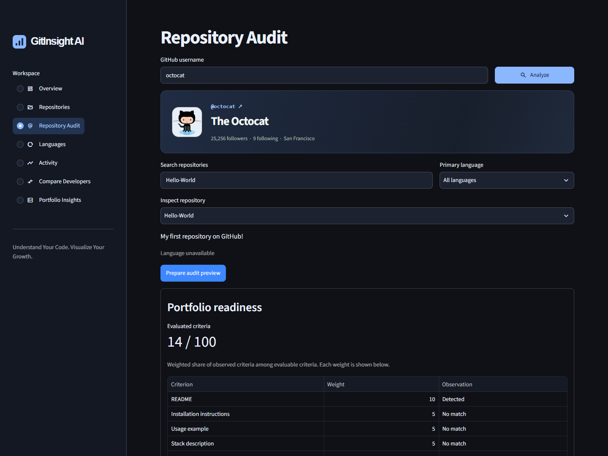
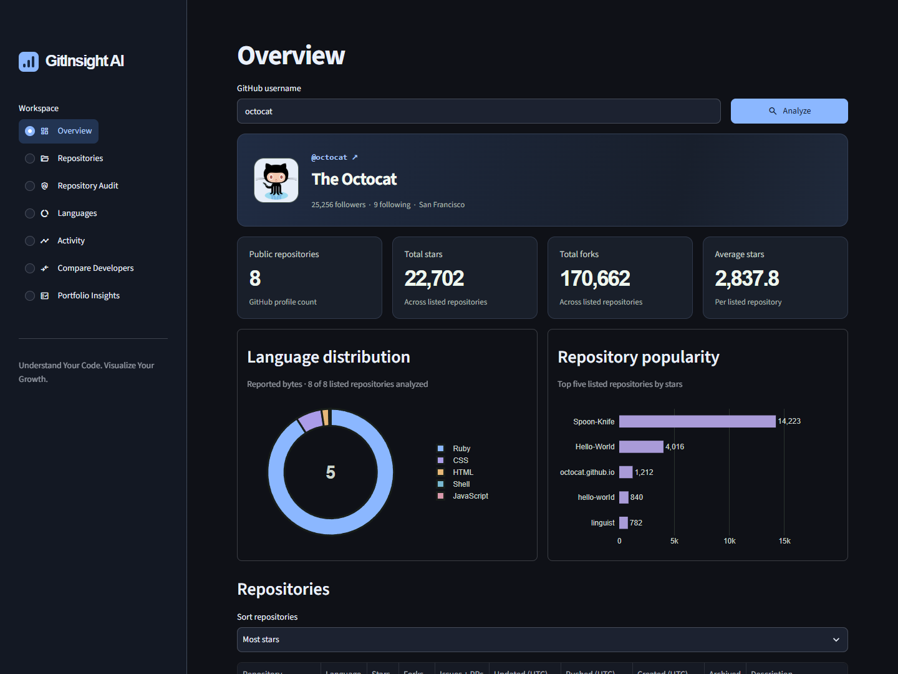
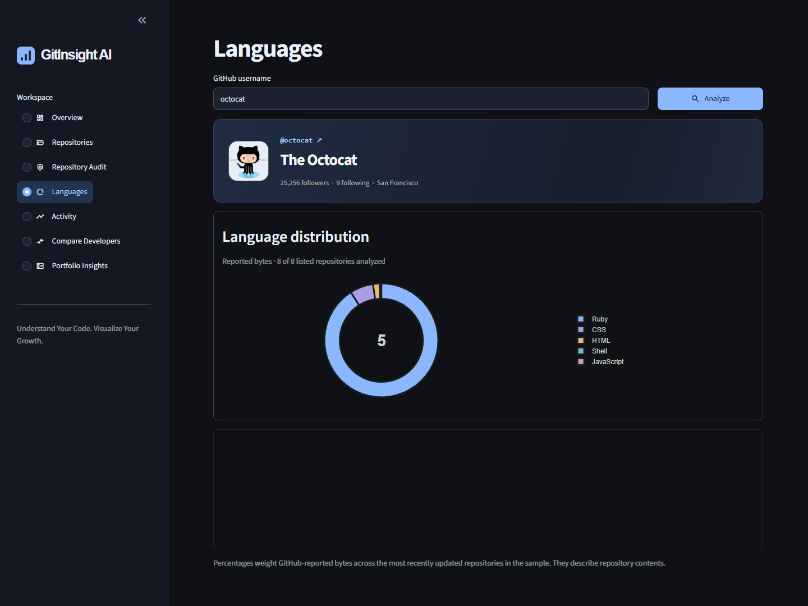
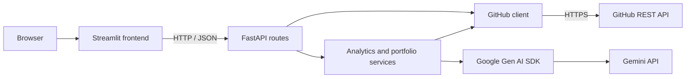

# GitInsight AI 2.0

**Intelligent GitHub Portfolio & Repository Auditor**

GitInsight is a public GitHub portfolio explorer built with FastAPI and Streamlit. Search a username to see the account's repositories, where their reported code bytes come from, and which projects have accumulated stars and forks. The initial view loads the public `octocat` account from GitHub.

## Repository audit

Open **Repository Audit**, choose a repository and select **Prepare audit preview**. Review the commit, selected paths, total bytes and weighted criteria. **Run AI Audit** sends the displayed sample to Google Gemini. Portfolio scoring and the static roadmap also work without Gemini credentials.

The backend checks public visibility, resolves the default branch and reads Git blobs from the commit tree. It samples documentation, manifests, workflow files, entry points and representative tests across Python, JS/TS, Java, C++, C# and Go. Unsupported, oversized, binary, generated and credential-like inputs are skipped. No repository code runs. Secret filters are heuristic and can miss unfamiliar formats.

The readiness percentage is earned weight divided by evaluated weight. A truncated tree or an unread README can leave criteria unevaluated. Each rule exposes its weight and observation. AI suggestions are separate from those observations. Gemini receives untrusted repository text without tool access. The backend validates JSON, checks cited paths and excerpts, and removes unverified line numbers. A matching excerpt alone cannot establish that a finding is correct. Review findings before acting. Roadmap checkboxes track session progress.

### Gemini configuration

Copy the blank Gemini entries from the example into your local ignored configuration. Set `GEMINI_API_KEY` and `GEMINI_MODEL` to a Google AI Studio key and a text-generation model available to that key with structured JSON support. Recreate the backend with `docker compose up -d --force-recreate backend`. [Google Gen AI SDK](https://googleapis.github.io/python-genai/)

Optional backend settings are `AUDIT_MAX_FILES` (8), `AUDIT_FILE_BYTES` (16000), `AUDIT_TOTAL_BYTES` (48000) and `AUDIT_GITHUB_CONCURRENCY` (4). A single backend worker serializes model calls and admits six new reviews per rolling hour, including failed attempts. Transient provider server errors have two bounded retries. Identical commit, model, input and policy combinations reuse successful reports for 15 minutes. Restarting the process resets this budget. Add authentication and shared quotas before enabling paid reviews on a public multi-worker service.

### Audit API

Under `/api/v1/repositories/{owner}/{repo}`, GET `audit-preview` or `portfolio-health` retrieves a deterministic snapshot. POST `audit` accepts the preview's commit in a JSON object with a `commit` field. A changed branch head returns 409. The audit report includes roadmap inputs, strengths, limitations and grounded findings. Missing credentials return 503 for AI requests.



## Problem

A profile page and a collection of individual repository pages answer different questions. GitInsight brings those records into one view and shows the scope of each calculation. A student preparing a portfolio can find projects missing descriptions or READMEs and follow links directly to the source repositories.

## Features

| View | What you can inspect |
| --- | --- |
| Overview | Public profile, followers, following, repository count, stars, forks, mean stars per listed repository, and top five repositories by stars |
| Repositories | Sort by stars, updates, forks, or name. Scroll the table horizontally for descriptions, archive status, open issues plus PRs, creation, update, and push dates. |
| Languages | Interactive donut, five leading languages, full byte table, percentage breakdown, and sample coverage |
| Activity | Select an owned public repository to view the latest 30 default-branch commits, UTC committer timestamps, and retrieved commits per date |
| Compare Developers | Compare two profiles side by side, including repository counts, popularity, language samples, and latest listed code push |
| Portfolio Insights | Review description, topic, license, preferred README, and root test-file checks with numerators, denominators, and rule explanations |

## Screenshots

The screenshots show the running application reading the public `octocat` account on November 19, 2026. Counts reflect the capture time.





## Technology stack

Python 3.12+, FastAPI, Pydantic v2, HTTPX, Uvicorn, python-dotenv, Streamlit, Plotly, and Pandas. Pytest exercises the API and UI. Ruff checks Python style. Docker Compose runs the two services together.

## Architecture



- **Frontend** owns navigation, input validation, chart rendering, and the active dashboard in session state. Selecting another dashboard section can reuse the loaded snapshot. Analyze loads it again.
- **API** validates inputs and publishes typed response models. The combined dashboard route uses the same repository listing for its table, totals, and language sample.
- **Client** owns authentication, timeouts, pagination, rate-limit cooldowns, and four concurrent upstream request slots. Successful responses of up to 512 KB can be reused for five minutes, with at most 128 entries per process. Concurrent identical requests share a cached success.
- **Services** separate aggregation from HTTP and rendering. Calculation tests can run with small fixtures and no network. The comparison service retains each side's available results.

## Installation on Windows

From the project root in PowerShell, install Python 3.12 or newer and run the following commands. The commands invoke the virtual environment directly and work without changing PowerShell's activation policy.

```powershell
py -3.12 -m venv .venv
.\.venv\Scripts\python.exe -m pip install -r requirements.txt
Copy-Item env.sample .env
```

## Environment variables

| Variable | Service | Default and purpose |
| --- | --- | --- |
| `GITHUB_TOKEN` | Backend | Empty enables anonymous public access. For a larger quota, supply a fine-grained token restricted to public repositories with read-only public metadata and contents access. |
| `GITINSIGHT_API_URL` | Frontend | `http://127.0.0.1:8000` for a local backend. Compose sets `http://backend:8000` inside its network. |

Keep credentials in the local ignored `.env` or the hosting provider's secret store. Restart the service after configuration changes. The frontend needs only the backend address. GitHub applies upstream limits to the token or, for anonymous traffic, the source IP. [GitHub rate limits](https://docs.github.com/en/rest/using-the-rest-api/rate-limits-for-the-rest-api)

## Running the backend

```powershell
.\.venv\Scripts\python.exe -m uvicorn backend.app.main:app --host 127.0.0.1 --port 8000
```

Check process health with `Invoke-RestMethod http://127.0.0.1:8000/health`.

## Running the frontend

In a second PowerShell terminal in the project root, run the command below and open [the dashboard](http://localhost:8501).

```powershell
.\.venv\Scripts\python.exe -m streamlit run frontend/app.py
```

Enter a public username and select **Analyze**. Choose **Repositories** to sort projects, or **Activity** to inspect a particular project's default branch. **Compare Developers** accepts two usernames independently of the current dashboard.

## Running tests and linting

```powershell
.\.venv\Scripts\python.exe -m pytest -q
.\.venv\Scripts\ruff.exe check .
.\.venv\Scripts\ruff.exe format --check .
```

HTTPX mock transports supply GitHub fixtures. The suite checks pagination, validation, missing accounts, timeouts, cooldowns, partial results, language weighting, repository rankings, activity attribution, portfolio rules, response schemas, and Streamlit form behavior. GitHub Actions runs the offline suite, lint, formatting, and container health checks on pushes and pull requests.

## API documentation

Open [Swagger UI](http://127.0.0.1:8000/docs) for schemas and interactive requests. The machine-readable specification is available at `/openapi.json`.

| GET route | Response |
| --- | --- |
| `/health` | Process health |
| `/api/v1/users/{username}` | Normalized public profile |
| `/api/v1/users/{username}/repositories` | Repository items, listing completeness, warnings |
| `/api/v1/users/{username}/analytics` | Popularity, language distribution, sample coverage |
| `/api/v1/users/{username}/dashboard` | Profile, listing, and metrics together |
| `/api/v1/users/{username}/activity?repo=NAME` | Selected public repository's commits and pagination status |
| `/api/v1/users/{username}/insights` | Rule definitions, observations and recommendations |
| `/api/v1/compare?user1=NAME&user2=NAME` | Two independently evaluated comparison results |

Invalid parameters return 422. Missing public resources return 404. Upstream rate limits return 429 with `Retry-After` on failed standalone requests. Upstream connectivity and timeout errors return 502 or 504. Partial views carry warnings or per-profile errors in successful responses.

## Docker and hosting

With Docker Desktop running in Linux-container mode, run the following commands from the project root. Stop local Python services using ports 8000 and 8501 before starting Compose.

```powershell
docker compose up --build --wait
docker compose ps
Invoke-RestMethod http://127.0.0.1:8000/health
Start-Process http://localhost:8501
```

Use `docker compose logs backend frontend` to inspect startup and `docker compose down` to stop the stack.

For a Linux host with Docker Compose, copy the project, configure the backend token, and run `docker compose up -d --build --wait`. The published ports bind to loopback. Route an HTTPS reverse proxy to port 8501 with WebSocket upgrades enabled for Streamlit. The dashboard contacts FastAPI over the internal Compose network. Check the public URL and perform a username search after configuring the host.

### Managed hosting on Render

After publishing the repository, create two Docker services in the same Render workspace and region. Use the repository root as each build context and keep the start commands from the Dockerfiles. [Render Docker configuration](https://render.com/docs/docker)

1. Create a private service using `Dockerfile.backend`. It listens on port 8000. Set the optional `GITHUB_TOKEN` on this service and copy its internal hostname. [Private services](https://render.com/docs/private-services)
2. Create a web service using `Dockerfile.frontend`. Set `PORT=8501`, configure `GITINSIGHT_API_URL` as `http://<internal-backend-hostname>:8000`, and use `/_stcore/health` for the health check. [Web service configuration](https://render.com/docs/web-services)
3. Open the frontend URL assigned by the provider, analyze a username, and verify that its repository link and language chart load.

## Known limitations and metric definitions

- Repository pagination reads up to ten pages of 100 public owned repositories, including forks and archived projects. Hitting the cap or losing a later page marks the listing incomplete. The profile count is GitHub's separate account-level field. Live changes during pagination can affect coverage.
- Language checks sample the eight most recently updated listed repositories. Empty responses count as successful checks with zero bytes. Failed responses are excluded and reported. Percentages divide each language's bytes by all returned bytes. A large repository can dominate this measure.
- Stars and forks describe public engagement. They provide no direct measure of code quality or individual proficiency. A repository's update timestamp can reflect a metadata change. The push timestamp reflects a code push.
- The commit view includes all authors and at most one page of 30 default-branch records. Its chart counts only retrieved commits with a committer date. The comparison's latest push is repository-level activity. Neither view measures a person's lifetime contributions.
- Descriptions, topics, and licenses use the listed repositories. README and test-file checks use the language sample selection rule. Percentages use only known results. Root test-file conventions can miss nested tests, other languages, or different naming schemes. They provide no evidence of passing tests. GitHub's root directory listing can be limited for exceptionally large directories.
- Caches and cooldowns belong to a single backend process. A browser session keeps its snapshot until another analysis. Anonymous GitHub quota is shared by users of the same public IP. Private work and contributions to other owners' repositories are outside the analysis.

## Future improvements

Add user-selected language samples, dated snapshots for longitudinal trends, and opt-in deeper test discovery with an explicit request budget.

## License

Released under the [MIT License](LICENSE).
